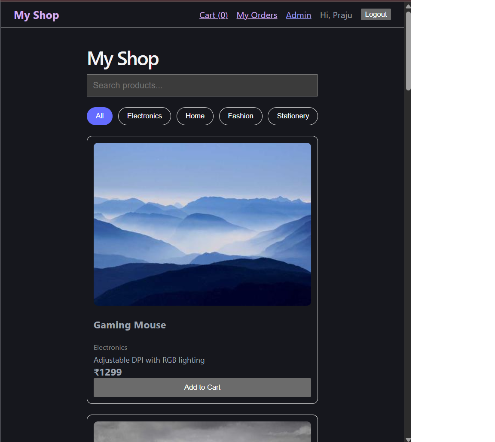

# My Shop: Full-Stack E-commerce App

A full-stack e-commerce web app built with React, Node.js, Express and MongoDB.

**Live demo:** https://ecommerce-app-alpha-dun.vercel.app

> The backend runs on a free tier, so the first load can take up to a minute while the server wakes up.

## Features
- Browse products with search and category filter
- Product detail pages
- Signup and login with JWT authentication (passwords hashed with bcrypt)
- Shopping cart saved in the browser
- Checkout and order history (server recalculates prices and checks stock)
- Admin page to add and delete products (role-based access)

## Tech stack
- **Frontend:** React (Vite), React Router, Axios
- **Backend:** Node.js, Express
- **Database:** MongoDB Atlas with Mongoose
- **Auth:** JWT, bcryptjs
- **Deployment:** Vercel (frontend), Render (backend)

## How it works
Browser (React) -> Express API on Render -> MongoDB Atlas

## Run locally
1. Clone the repo
2. Backend: `cd server`, `npm install`, create `.env` with `MONGO_URI`, `JWT_SECRET` and `PORT=5000`, then `node seed.js` and `node index.js`
3. Frontend: `cd client`, `npm install`, `npm run dev`

## Planned
- Razorpay payment (test mode)